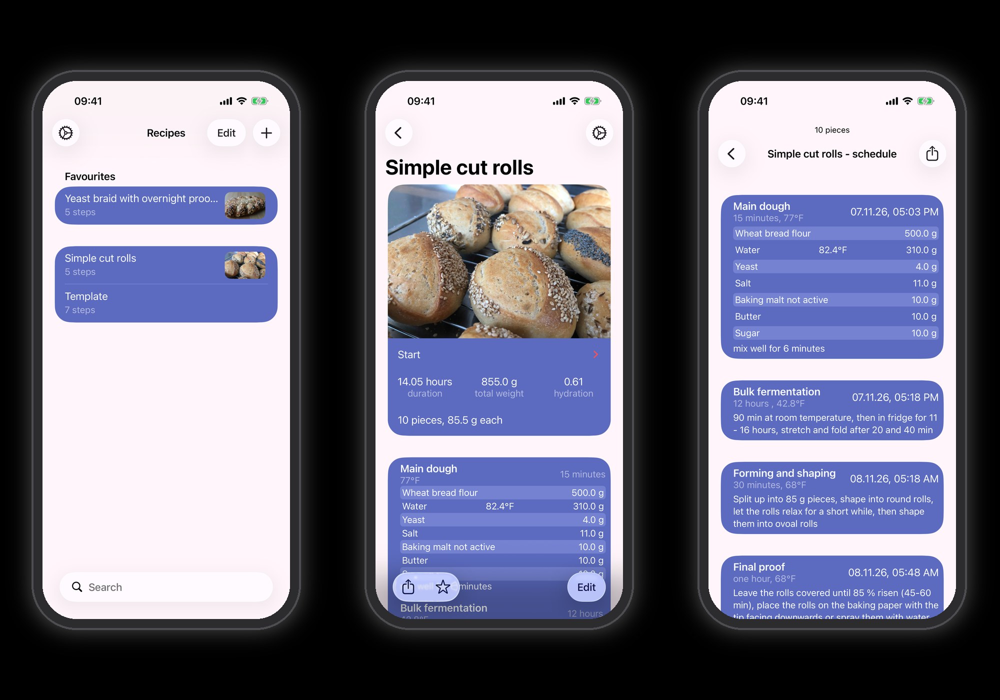
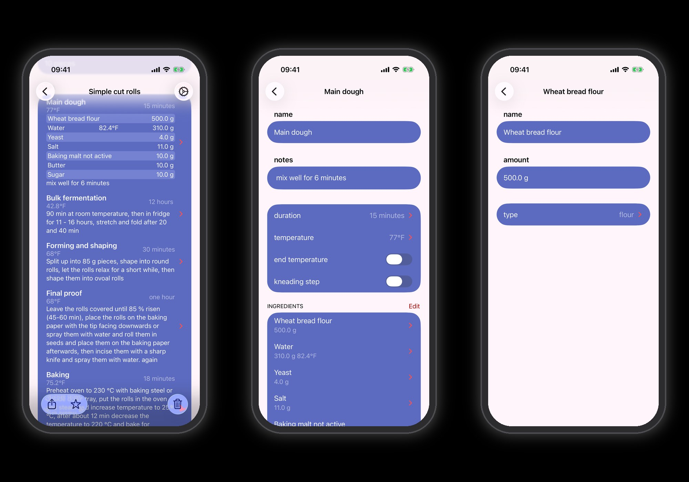

<!--
SPDX-FileCopyrightText: 2025 Moritz Schaub <moritz@pfaender.net>

SPDX-License-Identifier: AGPL-3.0-or-later
-->

# BackApp

A free and open source recipe database and baking planner for iPhone and iPad, made for bread baking.

[](https://apps.apple.com/us/app/back-app/id1574908433)



BackApp keeps your bread recipes in one place and turns them into a plan for baking day: when to start each step, how much of each ingredient you need, and how warm your water should be.

## Features

### Plan your baking day
- Choose when you want to start, or when the bread should be done, and BackApp works out the date and time of every step.
- Scale a recipe to the number of loaves or rolls you want to bake. For example, make 2 baguettes from a recipe written for 10.
- Share the finished schedule as text.

### Write down your recipes
- Recipes are made of steps, and each step has its own ingredients, duration, temperature and notes.
- A step can use another step as an ingredient, which is handy for starters, preferments and soakers.
- BackApp works out the temperature your water or other bulk liquid needs, based on the room temperature and, if you like, the heat added during kneading.
- Common ingredients such as flour and water are recognized by name, so their type is set for you.
- Add a photo, mark recipes as favourites and put your recipes in the order you want.

### Keep and share your recipes
- Everything is stored on your device. There is no account and no cloud service.
- Export single recipes or all of them to a `.bakingAppRecipe` file and import them again on another device, or send them to friends.
- New users start with a few example recipes. You can find them in [`ExampleRecipeFiles`](ExampleRecipeFiles).



The app is available in English and German. Translations into other languages are very welcome — see [Contributing](#contributing).

## Building the app

You need a Mac with a recent version of Xcode. The app runs on iOS and iPadOS 15 or later.

1. Clone the repository and open `BackApp.xcodeproj`.
2. Select the **Back App Debug** scheme and an iPhone or iPad simulator.
3. Build and run. Xcode fetches the Swift packages on the first build.

Tests run from the same scheme with **Product › Test**.

### Project layout

| Folder | Contents |
| --- | --- |
| `Back App iOS` | The iOS app: view controllers, cells and the app delegate |
| `BackAppCore` | Database access and app logic |
| `BakingRecipeFoundation` | The data models: recipes, steps and ingredients, stored with [GRDB](https://github.com/groue/GRDB.swift) |
| `BakingRecipeUIFoundation` | Shared UI code and colors |
| `BakingRecipeStrings` | All texts and their translations |
| `ExampleRecipeFiles` | The example recipes that are bundled with the app |

## Contributing

Pull requests are welcome. Please open them against the `devel` branch, not `master`.

- **New to the project?** Translations are a good place to start. All texts live in the `BakingRecipeStrings` package.
- **Looking for something to work on?** There are known bugs and UI issues in the [issue tracker](https://github.com/MoSchaub/BackApp/issues).
- **Adding a feature?** Large parts of the app are older UIKit code, and the architecture is not very tidy. New screens should be written in SwiftUI using MVVM, with one folder per screen or flow.
- **Licensing:** the project follows the [REUSE](https://reuse.software) specification, and CI checks it on every pull request. Add an SPDX header to new files, or an entry in `REUSE.toml` for files that can't have one.

### Updating the screenshots

The images in this README are made from the example recipes bundled with the app. To take new ones, run this on a Mac with Xcode and [Pillow](https://pypi.org/project/pillow/) installed:

```bash
scripts/screenshots/take_screenshots.sh "iPhone 16"
```

It runs the `ReadmeScreenshots` UI test on the simulator (the app is launched with `-screenshotMode`, which loads the example recipes) and writes `images/overview.jpeg` and `images/recipeManagement.jpeg`.

## Supporting the project

BackApp is free in the App Store, but many hours of work have gone into it, and publishing it in the App Store costs money. If you like the app, we would be very happy about a small [donation via PayPal](https://www.paypal.com/donate?hosted_button_id=UCSFW65PP6N3U).

## License

The source code is licensed under the [GNU Affero General Public License v3.0 or later](LICENSES/AGPL-3.0-or-later.txt). Images, colors and the example recipes are licensed under [CC BY-SA 4.0](LICENSES/CC-BY-SA-4.0.txt). See [`REUSE.toml`](REUSE.toml) and the file headers for the details of each file.
